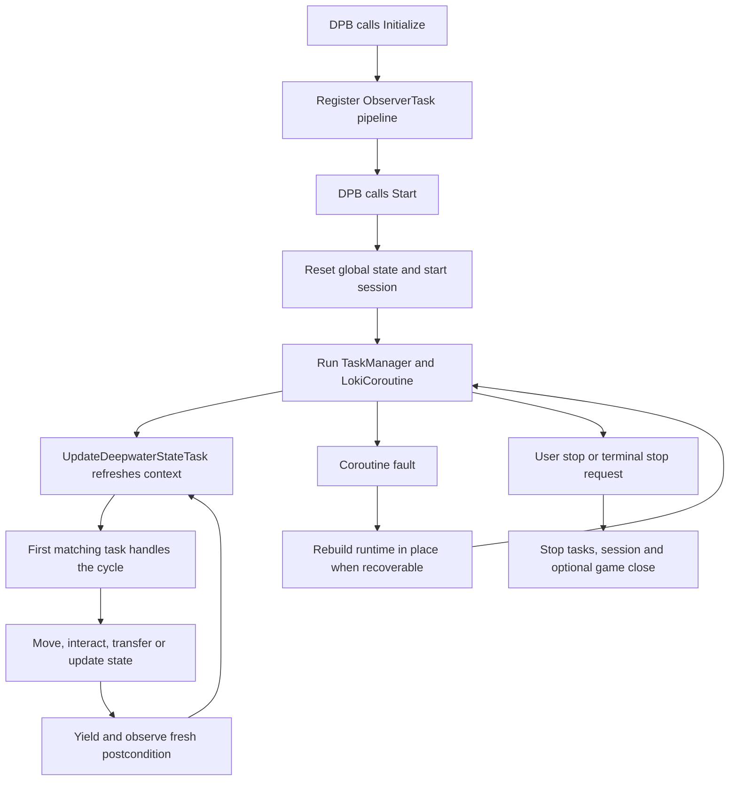

# Runtime Flow

## Purpose

Document the lifecycle and the first-handler-wins task cycle.

## Audience

Anyone changing startup, task ordering, recovery or phase transitions.

## Update when

Update when lifecycle callbacks, task order, phase definitions or recovery flow
changes.

## Depends on

[`architecture/overview.md`](overview.md),
[`architecture/state-model.md`](state-model.md) and
[`docs/runtime-lifecycle.md`](../docs/runtime-lifecycle.md).

## Phase sequence

- `NotInGame` and `OutsideContent`: wait for the supported content context.
- `SovereignHub`: stash, supply, bottle processing and travel preparation.
- `VoyagePlanning`: resolve stash, inventory charts, board slots and Begin Voyage.
- `ChartArea`: explore, collect lantern/sulphur, open chests and extract.
- `Voyage`: discover capsules, maintain lantern safety, loot and explore.
- `WaitingForBathysphere`: wait for or complete the extraction handoff.

## Task ownership rule

The registration order in `AllflameBot.Initialize` is part of the runtime
contract. A task can return handled without completing its whole workflow; it
then retains progress in state and lets a later cycle continue from the next
stage. Do not reorder tasks without checking every overlapping phase guard.

## Recovery rule

Recoverable exceptions refresh context, reset stale coroutine/task runtime and
resume the bot. This is distinct from `AllflameStopController`, which calls
`BotManager.Stop(false)`. Any change must state which category it belongs to.
